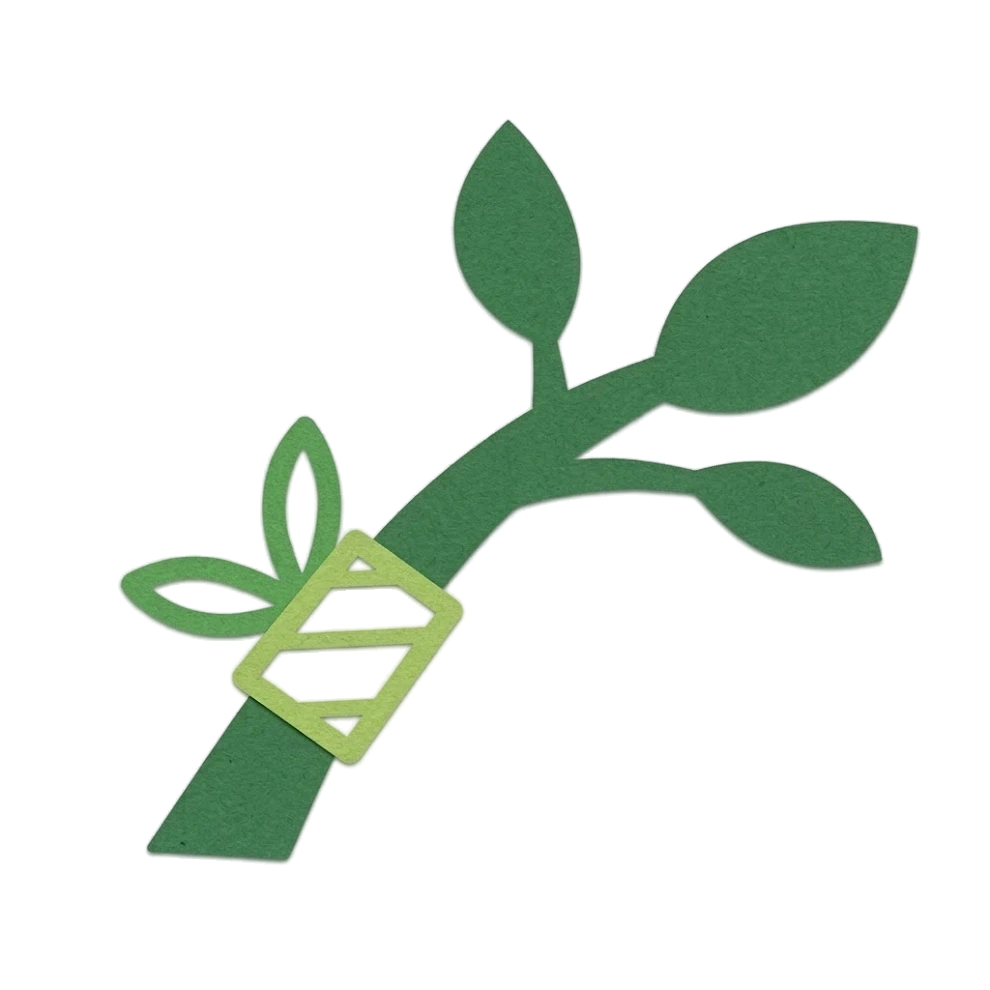

<div align="center">



# GRAFT: Geometric Refinement and Fitting Transformer for Human Scene Reconstruction

<p>
  <a href="https://pradyumnaym.github.io/" target="_blank">Pradyumna YM</a> ·
  <a href="https://yuxuan-xue.com/" target="_blank">Yuxuan Xue</a> ·
  <a href="https://fanegg.github.io/" target="_blank">Yue Chen</a> ·
  <a href="https://virtualhumans.mpi-inf.mpg.de/people/Kister.html" target="_blank">Nikita Kister</a> ·
  <a href="https://istvansarandi.com/" target="_blank">István Sárándi</a> ·
  <a href="https://virtualhumans.mpi-inf.mpg.de/people/pons-moll.html" target="_blank">Gerard Pons-Moll</a>
</p>

<p>
  <a href="https://pradyumnaym.github.io/graft/"></a>
  <a href="https://arxiv.org/abs/2604.19624"></a>
  <a href="https://huggingface.co/ympradyumna/graft"></a>
</p>

</div>

**TL;DR** — A learned HSI prior that predicts iterative geometry-grounded refinements
to reconstruct humans in scenes from a single image. Matches optimization-based
contact quality at **~50× lower runtime**; as a plug-and-play prior it boosts
existing methods by up to **44%** contact F1 — no retraining needed.


https://github.com/user-attachments/assets/0ce2b017-afa6-49c5-a016-d007e1ef7a93


This repository is the code release: the model, the demo, and the harness that
reproduces the paper's PROX and RICH numbers.

```python
from graft import GRAFTModel

model = GRAFTModel.from_pretrained("graft").cuda().eval()
out = model.predict("photo.jpg", scene_image="empty_room.jpg")

out.vertices     # (n_people, 10475, 3) SMPL-X vertices, scene frame, metres
out.smplx        # dict of SMPL-X parameters
out.points       # (H, W, 3) metric scene point map
```

GRAFT refines an existing per-frame pose estimate rather than detecting people
itself, so a photo with nobody in it raises `graft.NoPeopleDetected`.

---

## Roadmap

- [x] Project page
- [x] arXiv paper
- [x] Demo / inference code
- [x] Evaluation code and the PROX / RICH benchmark harness
- [ ] Training code

---

## Install

```bash
conda create -n graft python=3.10 && conda activate graft
bash install.sh              # everything: inference, benchmarks, demo extras
bash install.sh --minimal    # inference only
```

`install.sh` installs torch from the CUDA-matched index (`cu124`; override with
`TORCH_INDEX`), then the project, then the `eval` and `demo` extras from
`pyproject.toml` — one at a time, so that if one fails you still have a working
inference install rather than nothing. It tells you which failed and how to retry.

`pip install -e ".[all]"` installs the same set in one transaction, but skips the
CUDA-matched torch step, so run it only in an environment that already has the
right torch build.

`requirements-lock.txt` records the exact versions the published numbers were
produced with.

Then populate the data root:

```bash
python scripts/download_assets.py         # everything needed to run
python scripts/download_assets.py --eval  # + the benchmark assets
python scripts/check_install.py --all     # confirm the environment is ready
```

One command, three sources. Our weights and the benchmark assets we produced come
from [`ympradyumna/graft`](https://huggingface.co/ympradyumna/graft) on the Hub;
the NLF detector is a direct download from its GitHub release; and the SMPL-X body
models are account-gated, so the script prompts for those credentials. **Register
at <https://smpl-x.is.tue.mpg.de> first** — that is the only account you need.

Credentials go to the download portal and are not stored. `--skip-gated` opts out
and lists what to fetch by hand instead.

The data root is `$GRAFT_DATA_ROOT` (default `./data`); `$GRAFT_HF_REPO` points the
Hub source elsewhere.

After `python scripts/download_assets.py --eval` the data root looks like this:

```
data/                                       $GRAFT_DATA_ROOT (default ./data)
├── checkpoints/
│   ├── graft.pt                             65 MB    Hub
│   └── graft_no_visual.pt                   65 MB    Hub
├── body_models/
│   └── smplx/
│       ├── SMPLX_NEUTRAL.npz               109 MB    smpl-x.is.tue.mpg.de
│       └── SMPLX_MALE.npz                  109 MB    same archive, --eval only
├── nlf/
│   └── nlf_l_multi_0.3.2.patch1.torchscript 493 MB    isarandi/nlf release
├── scene_image.png                           1.8 MB   Hub, --eval
├── prox_quantitative_depth.pkl              17 MB     Hub, --eval
├── contact_vertice_weights.pkl               0.02 MB  Hub, --eval
└── imgs/rich/scene_imgs/                   234 MB     Hub, --eval (33 PNGs)

total ≈ 1.1 GB
```

Entries marked `--eval` are fetched only with that flag. `data/_downloads/` holds
the SMPL-X archive after extraction and can be deleted. The benchmark *datasets*
(PROX, RICH) live separately under `$GRAFT_BENCHMARK_ROOT` — see
[`docs/EVALUATION.md`](docs/EVALUATION.md).

---

## Checkpoints

Both load into the same `GRAFTModel`; they differ only in configuration.

| Name | What it is | Config difference |
|---|---|---|
| `graft` | the main model | — |
| `graft-no-visual` | the "without visual features" ablation | `drop_vis_feats=True` |

`drop_vis_feats` pushes every image sample point out of bounds, so the refinement
sees scene geometry only. The two also use different SMPL-X hand-mean conventions
(`flat_hand_mean`), so `from_pretrained` needs an explicit `GRAFTConfig` for a bare
checkpoint path rather than guessing one.

---

## The scene image

GRAFT takes **two views of the same camera**: the photo with the people in it, and
a view of the same scene *without* them. The second is where the geometry comes
from — the model needs to see the surface a person is occluding in order to place
them on it.

Both benchmarks supply a real empty-scene photograph. For your own images you have
three options, in descending order of quality:

1. **A real photo of the empty scene.** Best, and what the reported numbers use.
   ```python
   model.predict("photo.jpg", scene_image="empty_room.jpg")
   ```
2. **Inpaint the people out.** Segments with SAM, then removes them with a
   diffusion inpainter. Needs the `demo` extra. Both
   [`FLUX.1-dev`](https://huggingface.co/black-forest-labs/FLUX.1-dev) and
   [`Omnieraser`](https://huggingface.co/theSure/Omnieraser) are gated on the Hub,
   so accept their terms and `huggingface-cli login` first.

   FLUX is 31 GiB of bf16 weights, so `remove_people` picks how to fit it from
   the VRAM actually free: the whole pipeline on the GPU above ~35 GiB, one
   component at a time above ~26 GiB, and otherwise streaming submodules, which
   fits a 24 GiB card but is much slower. Override with `offload=` — see
   `graft.scene.remove_people`. The choice changes only where the weights live,
   never what is computed.
   ```python
   from graft.scene import remove_people
   model.predict("photo.jpg", scene_image=remove_people("photo.jpg"))
   ```
   or `python demo.py photo.jpg --inpaint-scene`
3. **Nothing** (`scene_image=None`). The image is reused as its own scene view, so
   the people occlude the geometry being fitted. A fallback, not a supported setting.

---

## Reproducing the published numbers

```bash
export GRAFT_BENCHMARK_ROOT=/path/to/datasets    # holds PROX/
python evaluate.py
```

`$GRAFT_BENCHMARK_ROOT` must contain `PROX/quantitative`, `PROX/proxd_full` and
`PROX/rich-sample100`. PROX and RICH are distributed by their own authors; this
repository redistributes neither.

**[`docs/EVALUATION.md`](docs/EVALUATION.md)** says exactly what to download for
each benchmark and how to lay it out. PROX is one 1.2 GB archive used as it
extracts; RICH is 100 specific frames that `scripts/build_rich_sample100.py`
assembles from your own RICH download.

Six metrics per benchmark: PA-MPJPE (mm), vertex-to-scene L2 (mm) and angle
(degrees), and contact precision / recall / F1. What this repository produces:

| model | benchmark | PA-MPJPE | V2S L2 | V2S angle | Prec | Rec | F1 | frames |
|---|---|---|---|---|---|---|---|---|
| `graft` | PROX | 49.73 | 184.36 | 50.92 | 0.556 | 0.638 | 0.594 | 174 |
| `graft` | RICH | 46.32 | 224.66 | 34.60 | 0.473 | 0.743 | 0.578 | 94 |
| `graft-no-visual` | PROX | 52.56 | 188.47 | 51.92 | 0.534 | 0.510 | 0.522 | 174 |
| `graft-no-visual` | RICH | 45.52 | 223.10 | 34.06 | 0.434 | 0.717 | 0.540 | 94 |

The `graft` rows are the published numbers, reproduced exactly. The
`graft-no-visual` rows differ from the paper's ablation by ~2 mm PA-MPJPE, which
predates the batched body fit used here; vertex-to-scene error and contact
precision/recall/F1 are essentially unchanged.

PROX-quantitative is 178 frames, of which 174 are scored; RICH is 100, of which 94
are scored.

Inference is not bitwise reproducible — GRAFT disables deterministic cuBLAS for
speed, so metrics move by order `1e-4` between runs, invisible at the precision
above.

---

## Provenance

`graft/` is **generated** from the research implementation the published results
were produced with: `tools/build_all.py` copies each numerical method by exact AST
source range, applies a small table of explicit edits (imports, paths, removing
training-only branches), and runs static checks over the result. So the released
forward pass is the same code, not a re-implementation.

To change something, edit the relevant script in `tools/` and re-run
`python tools/build_all.py`; a test fails if `graft/` is edited by hand.

---

## Performance

```bash
python benchmark.py --image photo.jpg --scene-image empty_room.jpg
```

**Inference latency is 174 ms** (5.7 images/s) on one H100, for a single image
with one person and three refinement iterations:

| stage | ms | share |
|---|---|---|
| geometry backbone (MapAnything) | 44.0 | 25% |
| pose init (NLF + batched body fit) | 43.3 | 25% |
| metric scale (MoGe) | 34.8 | 20% |
| refinement (3 iterations) | 33.1 | 19% |
| scene alignment | 9.9 | 6% |
| mesh posing (SMPL-X) | 2.6 | 1% |
| Python glue | 6.7 | 4% |
| **total** | **174.4** | 100% |

Measured from prepared input tensors: the images are decoded and resized once,
before the timed loop. `benchmark.py` exits non-zero if the median exceeds
`--budget` (200 ms by default).

---

## Licence

Our code is **MIT** (see [`LICENSE`](LICENSE)). The released **weights are for
non-commercial research use only** — GRAFT loads MapAnything (CC BY-NC 4.0), NLF
and SMPL-X at run time, all of which are non-commercial.

Vendored third-party code keeps its own licence: `third_party/mapanything/` is
Apache-2.0 (Meta), with our changes recorded in
[`third_party/PATCHES.md`](third_party/PATCHES.md).

## Citation

If you find our work useful, please consider citing:

```bibtex
@misc{ym2026graft,
  title        = {GRAFT: Geometric Refinement and Fitting Transformer for Human Scene Reconstruction},
  author       = {Pradyumna YM and Yuxuan Xue and Yue Chen and Nikita Kister and Istv{\'a}n S{\'a}r{\'a}ndi and Gerard Pons-Moll},
  year         = {2026},
  eprint       = {2604.19624},
  archivePrefix = {arXiv},
  url          = {https://arxiv.org/abs/2604.19624},
}
```

## Acknowledgements

GRAFT builds directly on [MapAnything](https://github.com/facebook/map-anything)
(scene geometry), [NLF](https://github.com/isarandi/nlf) (initialisation),
[MoGe](https://github.com/microsoft/MoGe) (metric scale),
[smplfitter](https://github.com/isarandi/smplfitter) (body fitting), and
optionally [WiLoR](https://github.com/rolpotamias/WiLoR) (hands) and
[OmniEraser](https://github.com/theSure/Omnieraser) (scene inpainting). See
`third_party/PATCHES.md`.
